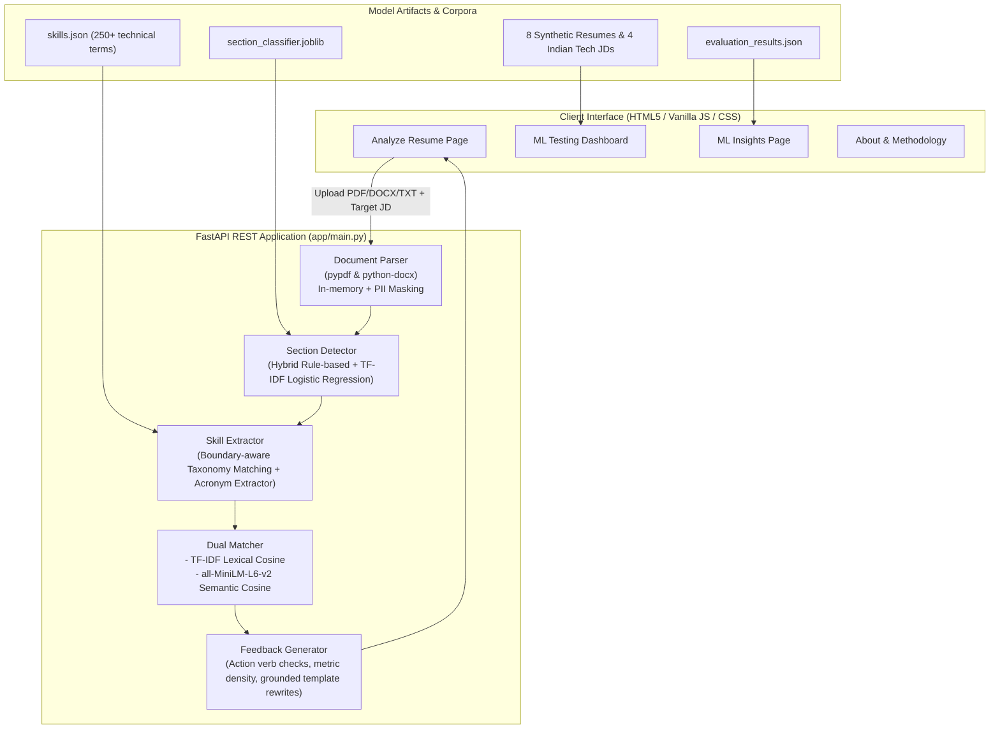

# ResumeScope (AI-Resume-Analyzer)

[](https://www.python.org/)
[](https://fastapi.tiangolo.com/)
[](https://scikit-learn.org/)
[](https://huggingface.co/sentence-transformers/all-MiniLM-L6-v2)
[](https://docs.pytest.org/)
[](LICENSE)

> **A reproducible, full-stack NLP system and testing dashboard for evidence-grounded resume and job description alignment.** Built specifically as a transparent personal review aid with zero applicant screening, zero candidate ranking, and non-inventing suggestions.

---

## Table of Contents

1. [Overview & Project Vision](#overview--project-vision)
2. [Responsible AI & Ethical Safeguards](#responsible-ai--ethical-safeguards)
3. [System Architecture & NLP Pipeline](#system-architecture--nlp-pipeline)
4. [Empirical Evaluation Benchmark](#empirical-evaluation-benchmark)
5. [Key Features](#key-features)
6. [Indian Tech Ecosystem Adaptation](#indian-tech-ecosystem-adaptation)
7. [Repository Structure](#repository-structure)
8. [Installation & Quick Start](#installation--quick-start)
9. [ML Testing Dashboard & Synthetic Fixtures](#ml-testing-dashboard--synthetic-fixtures)
10. [REST API Reference](#rest-api-reference)
11. [Running Automated Tests](#running-automated-tests)
12. [License & Citation](#license--citation)

---

## Overview & Project Vision

Most automated resume evaluation tools operate as opaque "black boxes" that assign arbitrary "hireability scores," claim to predict "ATS pass rates," or hallucinate candidate achievements through ungrounded generative LLM wrappers.

**ResumeScope** takes an ethical, transparent, and reproducible approach:
- **Evidence-Grounded**: Every piece of feedback references specific text segments and explainable taxonomy matches.
- **Privacy-First**: Documents are processed in-memory streaming buffers without saving to disk or retaining candidate PII.
- **Reproducible NLP**: Trained with clean, document-split machine learning pipelines (TF-IDF + class-weighted Logistic Regression, rule baselines, and dense MiniLM semantic embeddings).
- **Dedicated ML Testing Dashboard**: Allows engineers to test 8 synthetic personas, run batch functional tests, inspect model weights, and review true empirical metrics.

---

## Responsible AI & Ethical Safeguards

ResumeScope adheres strictly to responsible AI principles:

| Core Principle | Implementation in ResumeScope |
| :--- | :--- |
| **Personal Review Aid Only** | Built exclusively to help job seekers improve their document clarity. It is **never** used to screen applicants, rank candidates, or predict hiring decisions. |
| **No "Hireability" or "ATS" Scores** | Does **not** output applicant scores, probability of hiring, or claims of "beating the ATS". Similarity is reported strictly as wording and embedding similarity. |
| **No Hallucinated Qualifications** | Suggested rewrites use explicit template placeholders (e.g., `[add a measured result if you have one]`) rather than inventing skills, projects, or achievements. |
| **Honest Keyword Labeling** | Unmatched job description terms are phrased as *"not found in the provided resume text"*, rather than falsely claiming the user lacks the competency. |
| **Zero Demographic Inference** | Does not infer, evaluate, or log sensitive personal characteristics (age, gender, ethnicity, religion, disability, or marital status). Phone numbers and email addresses are masked upon parsing. |
| **Local Offline NLP Engine** | All models (section classifier, skill taxonomy, and dense sentence embeddings) execute locally without sending document content to third-party proprietary LLM APIs. |

---

## System Architecture & NLP Pipeline



---

## Empirical Evaluation Benchmark

All metrics reported below are genuine evaluation results calculated via `python src/evaluate.py` on held-out test splits with **strict document-level isolation** (zero data leakage).

### 1. Section Boundary Classification

Evaluated on 51 held-out sentences across 3 completely unseen resume documents (`data/processed/section_test.csv`):

| Model Architecture | Features | Macro F1 | Weighted F1 | Improvement |
| :--- | :--- | :---: | :---: | :---: |
| **Baseline Heuristic** | Regular Expressions & Heading Lexicons | `0.4181` | `0.4357` | *Baseline* |
| **ResumeScope Model** | **TF-IDF (1-3 n-grams) + Class-Weighted Logistic Regression** | **`0.8215`** | **`0.8431`** | **`+0.4034` (+96.5%)** |

#### Per-Class Performance Breakdown:
- **Summary**: Precision `0.8571`, Recall `1.0000`, **F1 `0.9231`**
- **Skills**: Precision `0.8182`, Recall `0.8182`, **F1 `0.8182`**
- **Experience**: Precision `0.8571`, Recall `0.8571`, **F1 `0.8571`**
- **Education**: Precision `1.0000`, Recall `0.8750`, **F1 `0.9333`**
- **Certifications**: Precision `0.7500`, Recall `1.0000`, **F1 `0.8571`**
- **Projects**: Precision `0.6667`, Recall `0.6667`, **F1 `0.6667`**
- **Other / Body**: Precision `0.8000`, Recall `0.6667`, **F1 `0.7273`**

### 2. Skill Extraction Accuracy

Evaluated against 8 hand-annotated technical resume test snippets (`data/processed/skill_extraction_eval.json`):
- **Precision**: `1.0000` (100% of detected taxonomy skills were true positives)
- **Recall**: `0.9655` (28 out of 29 annotated skills extracted)
- **F1 Score**: **`0.9825`**
- **Confusion Matrix**: True Positives: 28 | False Positives: 0 | False Negatives: 1

### 3. Resume-to-Job Matching Calibration

Evaluated against 12 human-annotated resume-job pairs with ordinal relevance grades:
- **Lexical Model (TF-IDF Cosine)**: Spearman rank correlation **`0.8932`**, Precision@1 **`100.0%`**
- **Semantic Model (`all-MiniLM-L6-v2`)**: Spearman rank correlation **`0.8870`**, Precision@1 **`100.0%`**

---

## Key Features

- **Multi-Format Ingestion**: Supports `.pdf`, `.docx`, and `.txt` files up to 5MB with fallback encodings (UTF-8, Latin-1, CP1252).
- **Hybrid Section Parsing**: Combines structural cues with machine learning to identify `Summary`, `Skills`, `Experience`, `Education`, `Projects`, and `Certifications`, even when non-standard headings are used.
- **Transparent Skill Taxonomy**: Curated hierarchy across 8 categories: Programming Languages, Frameworks, Cloud & DevOps, Databases, AI/ML, Data Engineering, Methodologies, and Developer Tools.
- **Candidate Acronym Detection**: Extracts capitalized technical abbreviations (e.g., `UPI`, `IMPS`, `JWT`, `RBAC`) that may not yet exist in the static dictionary.
- **Dual Text Similarity**: Reports both lexical TF-IDF overlap and semantic dense embeddings with clear non-applicant disclaimers.
- **Actionable Bullet Feedback**: Flags passive voice, missing action verbs, and unquantified achievements with safe template rewrites.
- **Export Options**: 1-click plain text summary report download and structured JSON download.

---

## Indian Tech Ecosystem Adaptation

ResumeScope is tailored for modern Indian engineering, product, and data roles:
- **Tech Hub Personas**: Built-in 1-click test roles for **Bengaluru** (Fintech / Backend), **Gurugram** (Product / Data Analytics), **Hyderabad** (Applied AI / ML), and **Pune** (Frontend Engineering).
- **Educational Qualifications**: Recognizes B.Tech, B.E., M.Tech, BCA, MCA, and CGPA formats (e.g., `8.7/10.0`).
- **Modern Domain Terminology**: Pre-trained on DSA (Data Structures & Algorithms), System Design, Microservices, Spring Boot, UPI / Payment Webhooks, Redis caching, and Kafka streaming.

---

## Repository Structure

```text
AI-Resume-Analyzer/
├── app/
│   ├── main.py                     # FastAPI application & no-cache middleware
│   ├── api/
│   │   ├── routes.py               # REST API endpoints (health, analyze, dashboard)
│   │   └── schemas.py              # Pydantic schemas for requests & responses
│   ├── services/
│   │   ├── document_parser.py      # PDF, DOCX, TXT in-memory parser & PII scrubber
│   │   ├── section_detector.py     # Hybrid rule + Logistic Regression section classifier
│   │   ├── skill_extractor.py      # Taxonomy matcher & regex acronym candidate detector
│   │   ├── matcher.py              # Lexical TF-IDF & dense sentence-transformers matcher
│   │   └── feedback.py             # Grounded feedback generator & non-inventing rewrites
│   └── static/
│       ├── index.html              # Embedded clean light SaaS frontend
│       ├── styles.css              # Full professional stylesheet
│       └── app.js                  # Client controller with error boundaries
├── src/
│   ├── data/
│   │   ├── prepare_dataset.py      # Dataset curation & anti-leakage splitting
│   │   └── split_dataset.py        # Document-level splitting script
│   ├── models/
│   │   ├── section_classifier.py   # Rule baseline & TF-IDF Logistic Regression classifiers
│   │   └── matching_models.py      # Lexical (TF-IDF) & Semantic (MiniLM) models
│   ├── train.py                    # Section classifier training script
│   ├── evaluate.py                 # Reproducible benchmark evaluation suite
│   └── predict.py                  # Standalone CLI inference pipeline
├── sample_resumes/
│   ├── README.md                   # Synthetic test fixtures documentation
│   ├── expected_test_cases.json    # Hand-authored expected test criteria
│   ├── sample_job_descriptions.json# Built-in Indian tech job specifications
│   ├── resume_01_software_engineer.txt # Rahul Sharma (Senior Backend, Bengaluru)
│   ├── resume_02_data_analyst.txt      # Pooja Verma (Data Analyst, Gurugram)
│   ├── resume_03_ml_intern.txt         # Sneha Kulkarni (ML Intern, IISc Bengaluru)
│   ├── resume_04_frontend_developer.txt# Ananya Iyer (Frontend, Chennai)
│   ├── resume_05_backend_developer.txt # Aarav Patel (Backend, Pune, embedded skills)
│   ├── resume_06_cybersecurity_trainee.txt # Priya Shukla (Security, Hyderabad)
│   ├── resume_07_project_manager.txt   # Vikramaditya Rao (Project Manager, Noida)
│   └── resume_08_minimal_resume.txt    # Aditi Sen (Sparse resume test case)
├── data/
│   ├── taxonomy/skills.json        # Curated technical skill taxonomy (250+ entries)
│   ├── raw/                        # Raw annotated sentences
│   └── processed/                  # Document-split train/val/test CSVs
├── configs/config.yaml             # Global system configurations & thresholds
├── models/
│   ├── section_classifier.joblib   # Serialized Logistic Regression model
│   └── model_metadata.json         # Hyperparameters, F1 scores & training logs
├── results/
│   ├── dataset_summary.json        # Corpus split counts and class distribution
│   ├── evaluation_results.json     # Empirical benchmark evaluation results
│   └── error_analysis.json         # Diagnostic false positives & error analysis
├── tests/                          # Comprehensive pytest test suite (28 tests)
│   ├── test_api.py                 # REST API endpoints & error handling tests
│   ├── test_parser.py              # In-memory PDF, DOCX, TXT parsing tests
│   ├── test_sections.py            # Section detector unit tests
│   ├── test_skills.py              # Skill taxonomy & acronym detection tests
│   ├── test_matcher.py             # Lexical & semantic matcher unit tests
│   ├── test_feedback.py            # Feedback generator & non-inventing template tests
│   └── test_synthetic_fixtures.py  # 8 synthetic resume regression test cases
├── requirements.txt                # Production dependencies
├── pytest.ini                      # Pytest runner configuration
├── LICENSE                         # MIT License
└── README.md                       # Complete documentation
```

---

## Installation & Quick Start

### 1. Prerequisites
- Python 3.10+ (Python 3.11 recommended)
- Git

### 2. Clone the Repository
```bash
git clone https://github.com/rishavrjpt/AI-Resume-Analyzer.git
cd AI-Resume-Analyzer
```

### 3. Create and Activate Virtual Environment
```bash
# macOS / Linux
python3 -m venv .venv
source .venv/bin/activate

# Windows (Command Prompt)
python -m venv .venv
.venv\Scripts\activate.bat
```

### 4. Install Dependencies
```bash
pip install --upgrade pip
pip install -r requirements.txt
```

### 5. (Optional) Re-train & Evaluate ML Models
```bash
# Prepare dataset splits
python src/data/prepare_dataset.py

# Train section classifier
python src/train.py

# Run benchmark evaluation
python src/evaluate.py
```

### 6. Start the Web Application
```bash
python -m uvicorn app.main:app --host 127.0.0.1 --port 8000 --reload
```

Open your browser at **[http://127.0.0.1:8000](http://127.0.0.1:8000)**.

---

## ML Testing Dashboard & Synthetic Fixtures

ResumeScope provides a dedicated **ML Testing Dashboard** designed for software engineers and ML practitioners to evaluate system behavior without requiring private personal resumes:

1. **8 Fictional Personas**: Pre-loaded synthetic fixtures covering edge cases:
   - *Standard with Dedicated Skills*: Rahul Sharma (`resume_01_software_engineer.txt`)
   - *Embedded Skills inside Project Bullets*: Aarav Patel (`resume_05_backend_developer.txt`)
   - *Sparse / Incomplete Structure*: Aditi Sen (`resume_08_minimal_resume.txt`)
   - *Academic / Research Oriented*: Sneha Kulkarni (`resume_03_ml_intern.txt`)
2. **Batch Functional Execution**: Select one or multiple test resumes, assign a target job description, and execute batch regression testing with real-time progress bars.
3. **Data Export**: Export test run results directly to structured **JSON** or **CSV** for regression tracking.
4. **Independent from Training**: Synthetic testing fixtures are strictly isolated from model training and evaluation benchmarks.

---

## REST API Reference

Interactive OpenAPI (Swagger) documentation is available at **`/docs`** when the server is running.

### Core Endpoints

| Method | Endpoint | Description |
| :--- | :--- | :--- |
| `GET` | `/api/health` | System health check, active model statuses, and dataset availability. |
| `GET` | `/api/model-info` | Metadata, hyperparameters, and training statistics for the section classifier. |
| `POST` | `/api/analyze` | Multi-part form upload (`resume_file` + optional `job_description`) returning full JSON analysis. |
| `GET` | `/api/sample-resume/{filename}` | Fetches raw text of synthetic fixtures for 1-click testing. |
| `GET` | `/api/test-samples` | Lists synthetic resume fixtures, test personas, and built-in job descriptions. |
| `POST` | `/api/test-samples/run` | Executes batch regression testing on selected synthetic resumes. |
| `GET` | `/api/insights` | Retrieves actual empirical evaluation results, confusion matrices, and error analysis. |

---

## Running Automated Tests

Run the full pytest test suite (28 automated tests covering parsers, ML classifiers, skill extractors, feedback generation, and synthetic fixtures):

```bash
pytest tests/ -v
```

Output:
```text
============================== test session starts ==============================
collected 28 items

tests/test_api.py::test_api_health PASSED                                 [  3%]
tests/test_api.py::test_api_model_info PASSED                             [  7%]
tests/test_api.py::test_api_analyze_txt_file PASSED                       [ 10%]
tests/test_api.py::test_api_analyze_missing_file_error PASSED             [ 14%]
tests/test_api.py::test_api_insights PASSED                               [ 17%]
tests/test_api.py::test_api_test_samples PASSED                           [ 21%]
tests/test_api.py::test_api_run_sample_tests PASSED                       [ 25%]
tests/test_feedback.py::test_weak_verb_flagging PASSED                    [ 28%]
tests/test_feedback.py::test_missing_sections_feedback PASSED             [ 32%]
tests/test_feedback.py::test_long_bullet_flagging PASSED                  [ 35%]
tests/test_matcher.py::test_lexical_similarity_bounds PASSED              [ 39%]
tests/test_matcher.py::test_empty_text_matching PASSED                    [ 42%]
tests/test_matcher.py::test_term_comparison_categorization PASSED         [ 46%]
tests/test_matcher.py::test_similarity_disclaimer_presence PASSED         [ 50%]
tests/test_parser.py::test_txt_parsing_valid PASSED                       [ 53%]
tests/test_parser.py::test_unsupported_file_extension PASSED              [ 57%]
tests/test_parser.py::test_empty_file_rejected PASSED                     [ 60%]
tests/test_parser.py::test_oversized_file_rejected PASSED                 [ 64%]
tests/test_parser.py::test_corrupt_pdf_handling PASSED                    [ 67%]
tests/test_parser.py::test_docx_generation_and_parsing PASSED             [ 71%]
tests/test_sections.py::test_rule_based_heading_patterns PASSED           [ 75%]
tests/test_sections.py::test_section_detector_segmentation PASSED         [ 78%]
tests/test_sections.py::test_section_detector_missing_handling PASSED     [ 82%]
tests/test_skills.py::test_taxonomy_loading PASSED                        [ 85%]
tests/test_skills.py::test_multi_word_and_special_char_skills PASSED      [ 89%]
tests/test_skills.py::test_skill_context_snippets PASSED                  [ 92%]
tests/test_skills.py::test_candidate_acronym_extraction PASSED            [ 96%]
tests/test_synthetic_fixtures.py::test_all_eight_synthetic_resumes_against_expected_cases PASSED [100%]

======================== 28 passed, 1 warning in 3.83s =========================
```

---

## License & Citation

This project is licensed under the **MIT License** — see the [LICENSE](LICENSE) file for details.

### Citation
```bibtex
@software{resumescope2026,
  author = {Rishav Raj},
  title = {ResumeScope: An AI/ML Resume and Job Description Alignment Analyzer},
  year = {2026},
  url = {https://github.com/rishavrjpt/AI-Resume-Analyzer}
}
```
